<h1>Dimas Arief Maryadi</h1>

**Building better things, one commit at a time.**

🍁 紅葉 · Autumn in Japan

## 🛠️ Tech Stack

<!-- Sesuaikan daftar badge ini dengan skill Dimas -->

  
  
  
  
  
  
  
  
  
  
  

  

